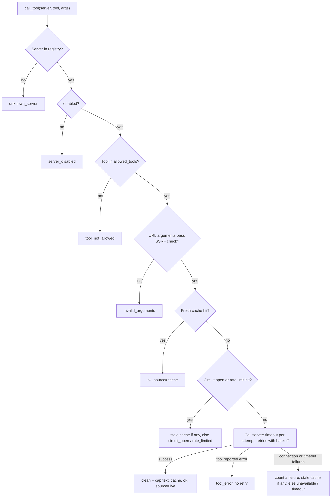

# MCP in AI Talent Hub

How the backend talks to external MCP (Model Context Protocol) servers, why it is built this way, and the rules for adding a server.

**Tracker:** Phase 6, tasks 6 (client approach), 7, 8, 10, 11, 12, 13. Decision references: D2, D3.

## 1. What MCP is used for

MCP servers give us **reference data** from outside the app: interview-experience notes, role descriptions, learning resources. The platform uses that data to *enrich* interviews and roadmaps, never to decide anything.

Two rules follow from that:

- **MCP is optional.** If every server is down, interviews, roadmaps, ATS scoring and recruiter ranking still work. They just have less reference material.
- **MCP output is untrusted.** It is text written by someone else. It goes into prompts only as clearly marked data.

## 2. Decision: official `mcp` SDK, not LangChain's MCP adapter

| | Official `mcp` SDK (chosen) | `langchain-mcp-adapters` |
|---|---|---|
| Who decides to call a tool | Our code | Usually the LLM, once tools are bound to an agent |
| Timeouts, retries, headers, redirects | We set them per server | Hidden behind the adapter |
| Error handling | We turn every failure into a result object | Errors surface inside the agent loop |
| Dependencies | `mcp` only | Adapter plus LangChain glue (the adapter depends on `mcp` anyway) |
| Fit for our use | Deterministic, auditable enrichment calls | Good for autonomous tool-using agents |

Why this matters here: our agents are LangGraph state machines with fixed steps. We want *code* to decide when to fetch reference data, which server and tool to use, and what to do if it fails. Letting a model pick tools from external servers would also widen the prompt-injection surface (a hostile tool description could steer it).

If a future agent genuinely needs model-driven tool use, it should still go through the gateway, not around it.

## 3. The gateway: one controlled door

All MCP traffic goes through `app/mcp/gateway.py`. Application code uses only `get_gateway()`.

```python
from app.mcp.gateway import get_gateway

result = await get_gateway().call_tool(
    "demo_reference", "search_reference_notes", {"query": "STAR method"}
)
context = result.as_prompt_context()  # "" when the call failed or returned nothing
prompt = f"{base_prompt}\n\n{context}" if context else base_prompt
```

The gateway **never raises for operational problems**. A failure comes back as `ToolResult(ok=False, error_code=...)`, so a caller can always carry on without the data.

### Order of checks for every call



Nothing reaches the network until the registry, allowlist and URL checks pass.

### Results

`ToolResult` fields: `ok`, `server`, `tool`, `text`, `source`, `error_code`, `error`, `truncated`, `latency_ms`, `meta`.

| `source` | Meaning |
|---|---|
| `live` | Fresh answer from the server |
| `cache` | Answered from the fresh cache window, no call made |
| `stale_cache` | Server unusable; an older answer was served. `meta["degraded_reason"]` says why |
| `unavailable` | No data (see `error_code`) |

| `error_code` | Cause | Retried? | Counts toward circuit breaker? |
|---|---|---|---|
| `unknown_server` | Name not in registry | no | no |
| `server_disabled` | `enabled: false` | no | no |
| `tool_not_allowed` | Tool not in `allowed_tools` | no | no |
| `invalid_arguments` | URL argument failed the SSRF check | no | no |
| `not_configured` | Missing API key env var, or stdio in production | no | no |
| `rate_limited` | Per-server calls per minute exceeded | no | no |
| `circuit_open` | Server recently failed; skipped during cooldown | no | no |
| `timeout` | No answer within `timeout_seconds` | yes | yes |
| `unavailable` | Connection failed or server unreachable | yes | yes |
| `tool_error` | Server was reachable but the tool reported an error | no | no |

`rate_limited` and `circuit_open` serve a stale cached answer when one exists.

## 4. Graceful degradation (task 11)

Three layers, in order:

1. **Cache.** Results are kept in memory for `cache_ttl_seconds`; identical calls inside that window never reach the server.
2. **Stale cache.** If the server then fails (or is skipped by the circuit breaker or rate limit), an answer up to `stale_ttl_seconds` old is served and marked `stale_cache`.
3. **No-reference fallback.** With nothing cached, the caller gets `ok=False` and builds its prompt without reference data.

Protection against a dead server dragging everything down:

- **Retries:** up to `max_retries` extra attempts with exponential backoff, only for timeouts and connection errors.
- **Circuit breaker:** after 3 failed calls in a row (each counted after its retries are used up), the server is skipped for 30 seconds. After the cooldown the next call tries again: one more failure re-opens the circuit, one success resets it.
- **Rate limit:** per server, per minute.

Limits to know about:

- The cache, rate-limit counters and circuit state live **in process memory**. They reset on restart, and each uvicorn worker keeps its own. A shared (Redis) cache is a possible later step if it ever matters.
- Each call opens a short-lived session (connect, initialise, call, close). That keeps the gateway stateless; the cache removes most repeated cost.

## 5. Security controls (task 10)

| Threat | Control | Where |
|---|---|---|
| Calling an unvetted server | Registry is the only list; new servers start `enabled: false` | `mcp_servers.yaml`, `config.py` |
| A tool doing more than intended | Per-server `allowed_tools`, read-only tools only by convention | `gateway.py` |
| SSRF through a URL argument | Scheme must be http(s), no credentials, host must be on the server's `allowed_url_domains`, every resolved IP must be public. Empty allowlist means no URL arguments at all | `security.py` |
| Prompt injection via tool output | Text is control-character stripped and size-capped. `as_prompt_context()` wraps it in `<<<EXTERNAL_CONTENT ... EXTERNAL_CONTENT>>>` with a "data, not instructions" line, and defangs any copy of those delimiters inside the text | `security.py`, `ToolResult` |
| Leaking API keys | Registry stores only the env var **name**; keys are sent as a header only. Errors pass through `scrub_secrets`. Logs record argument **key names**, never values | `config.py`, `gateway.py` |
| A server bouncing us to another host | The HTTP client does **not** follow redirects | `gateway.py` |
| Arbitrary local commands | `stdio` transport is refused when `APP_ENV=production` | `gateway.py` |
| Plain-text traffic | `http://` accepted only with `internal: true` (our own Docker-network servers) | `config.py` |
| A server changing under us | `/api/health/mcp` lists `missing_allowed_tools` if an allowlisted tool disappears | `gateway.py` |
| Resume text leaking into logs | Argument values are never logged | `gateway.py` |

### Known limits

- **DNS rebinding.** The SSRF check resolves the hostname before the call, but the MCP server does its own lookup later. A hostile DNS server could answer differently the second time. Mitigations: keep `allowed_url_domains` short and trusted, and prefer tools that take no URLs.
- **Injection is contained, not detected.** The delimiters reduce risk but cannot guarantee the model ignores hostile text. Scanning for injection is Phase 11.
- **Version drift.** A third-party server can change behaviour between calls. Pin versions for servers we run, and treat the health check's `missing_allowed_tools` as an alarm.

## 6. The registry (`app/mcp/mcp_servers.yaml`)

The YAML file's header comment lists every field and its default. Key rules:

- Secrets never go in the file; `api_key_env` names a variable (UPPER_SNAKE_CASE), the value lives in `.env`.
- `url_env` overrides `url` from the environment (this is how Docker points the backend at `mcp-demo`).
- `MCP_REGISTRY_PATH` loads a different registry file.
- A bad registry fails loudly: `RegistryError` at load, and `/api/health/mcp` reports `misconfigured`.

### Adding a server

1. Run it through the vetting checklist (`docs/mcp/vetting-checklist.md`, Phase 6 task 9): licence, maintenance, auth, rate limits, terms of service.
2. Add the entry with `enabled: false` and the **smallest** `allowed_tools` list that works.
3. Set `allowed_url_domains` only if a tool takes URLs.
4. Put the key in `.env` and reference it with `api_key_env`.
5. Check it with `await get_gateway().list_tools("name")` and look at `missing_allowed_tools` in the health output.
6. Flip `enabled: true` in a reviewed change.

## 7. Operations

- **Health:** `GET /api/health/mcp` returns `ok`, `degraded`, `no_servers_enabled` or `misconfigured`, always HTTP 200 (a down MCP server must not make the app look dead; `/health` stays the liveness probe). It reports status, latency, tool count and error code only, never URLs or keys, and is cached for 10 seconds.
- **Demo server:** `docker/mcp-demo` is our own reference server for end-to-end tests. Start it with `docker compose -f docker/docker-compose.yml --profile demo up -d mcp-demo`, and set `enabled: true` on `demo_reference` locally. Keep it `false` when committing.
- **Logs:** one line per call: server, tool, ok, source, error code, latency, argument key names.

## 8. Dependency pins

`mcp==1.12.4` only works with the pinned set in `backend/requirements.txt`: `pydantic==2.9.2`, `starlette==0.38.6`, `sse-starlette==3.0.3`, `httpx==0.27.2`, `uvicorn==0.30.6`. An unpinned newer pydantic breaks the import.

**Do not bump `mcp` or pydantic on their own.** Upgrade them together and run `pytest tests/unit/mcp`. The tests also use the SDK's private `server._mcp_server` attribute, which is another reason to pin.

## 9. Testing (task 12)

`tests/unit/mcp/` contains 69 tests and needs no network. `fake_server.py` is a real FastMCP server connected to the real client session through in-memory streams, so the protocol code runs for real. It has tools for the awkward cases: huge output, errors, slow responses, hostile text, control characters and URL arguments.

`FakeServerKit` counts sessions opened (to prove the cache answered) and has switches for connection failures and a server that is always down.

## 10. What comes next

- **Phase 6 spike:** vet candidate servers and data sources; nothing is enabled until it passes.
- **Phase 7:** the RAG rebuild becomes the first real caller of the gateway.
- **Phase 11:** injection detection on MCP output and guardrails on what reaches prompts.
- **Phase 12:** gateway metrics (calls, cache hit rate, circuit state) on the monitoring dashboard.